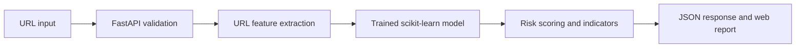

<div align="center">

# PHISHGUARD

### Look twice before you trust a link.

**A machine-learning phishing URL detector with interpretable risk signals and a customizable web interface.**

[](https://www.python.org/)
[](https://fastapi.tiangolo.com/)
[](https://scikit-learn.org/)
[](#limitations)

[Overview](#overview) · [Features](#features) · [Architecture](#architecture) · [Quick start](#quick-start) · [Model development](#model-development) · [API](#api-reference) · [Limitations](#limitations)

</div>

---

## Overview

**PhishGuard** is a research-oriented phishing website detection prototype. Enter an HTTP or HTTPS URL and receive a machine-learning classification, a 0–100 **model-derived risk score**, suspicious URL indicators, and practical safety recommendations.

The currently served model analyzes **URL structure only**. It does **not** visit the website, download page HTML, verify a site's identity, or guarantee that any link is safe. The risk score is derived from an **uncalibrated** model output, so it must not be interpreted as a statistically calibrated likelihood of phishing.

The project combines reproducible feature extraction, traditional supervised machine learning, a FastAPI inference endpoint, and a responsive, multi-theme frontend.

## Features

| Area | Implementation |
|:--|:--|
| URL analysis | 15 handcrafted lexical and structural features |
| Models | Logistic Regression, Random Forest, Gradient Boosting |
| Model selection | F1-based validation comparison |
| Evaluation | Domain-grouped training / validation / held-out testing in `scripts/train_live_model.py` |
| Risk report | Classification, uncalibrated score, severity band, rule-based indicators, recommendations |
| API | FastAPI endpoints with request validation |
| Interface | Responsive HTML/CSS/JavaScript frontend with ten configurable visual themes |
| Tests | Feature-related pytest tests and additional script-level checks |

### What gets analyzed?

Examples of signals include URL length, hostname length, IP-address hostnames, HTTPS scheme, special characters, `@` symbols, query-parameter counts, Punycode, numeric proportions, explicit ports, and URL-character entropy. See [`backend/features/live_url_features.py`](backend/features/live_url_features.py) for the full feature definition.

## Architecture



```text
Phishing-Detection-System/
├── backend/
│   ├── main.py                 # FastAPI app and frontend routes
│   ├── features/               # URL feature extraction and exploratory modules
│   ├── ml/                     # Inference and feature schema
│   ├── risk/                   # Risk levels, indicators and recommendations
│   └── security/               # Security-related modules
├── frontend/
│   ├── index.html
│   ├── css/style.css
│   └── js/
│       ├── app.js
│       └── config.js           # Theme settings
├── models/
│   └── url_model.joblib        # Model artifact used by the API
├── scripts/
│   ├── train_live_model.py     # Current URL-only training workflow
│   ├── train_models.py         # Separate experimental training workflow
│   └── prepare_dataset.py
├── data/                       # Research data (see dataset notes)
├── reports/                    # Experiment outputs
├── tests/                      # Automated tests
├── requirements.txt
└── README.md
```

> The diagram and tree show the **current inference path** and key files; not all exploratory modules are active in production inference.

## Quick start

### Requirements

- Python 3.10+ and `pip`
- A working copy of [`models/url_model.joblib`](models/url_model.joblib)

### Run locally (macOS / Linux)

```bash
# Clone
 git clone https://github.com/maanik-chandela/Phishing-Detection-System.git
 cd Phishing-Detection-System

# Environment
 python3 -m venv .venv
 source .venv/bin/activate
 pip install -r requirements.txt

# Start the backend, which also serves the frontend
 python -m uvicorn backend.main:app --reload --host 127.0.0.1 --port 8000
```

Open **http://127.0.0.1:8000/** for the interface. The API documentation is at **http://127.0.0.1:8000/docs** and the health check is at **http://127.0.0.1:8000/health**.

> Only load `joblib` model artifacts from sources you trust: serialized Python artifacts can execute code when loaded.

## API reference

### `GET /health`

Reports application status and whether the predictor initialized.

### `POST /analyze`

```bash
curl -X POST http://127.0.0.1:8000/analyze \
  -H 'Content-Type: application/json' \
  -d '{"url":"https://example.com"}'
```

The response includes these fields (values vary with the URL and model):

| Field | Meaning |
|:--|:--|
| `prediction` | `0` = classified legitimate; `1` = classified phishing |
| `phishing_probability` | Uncalibrated model score for the phishing class |
| `risk_score` | Rounded `phishing_probability × 100` |
| `risk_level` | Low (`<25`), Medium (`25–49`), High (`50–74`), Critical (`75–100`) |
| `indicators` | Explanations generated from URL-specific rules |
| `recommendations` | General safety advice, with extra guidance for higher risk levels |
| `features` | Extracted URL feature values |
| `model_name` | Selected model identifier stored in the artifact |
| `analysis_mode` | `URL-only` |
| `score_calibrated` | `false` |

Only `http://` and `https://` URLs with a valid hostname are supported.

## Model development

The main serving model is built by [`scripts/train_live_model.py`](scripts/train_live_model.py):

1. Load URL/label columns from `data/raw/All_Features_threshold90.xlsx`.
2. Remove incomplete, conflicting, and duplicate URL entries.
3. Extract the same 15 URL-based features used at inference.
4. Split by registered domain using `GroupShuffleSplit` to reduce domain overlap between development and held-out testing.
5. Compare Logistic Regression, Random Forest, and Gradient Boosting on the validation split using F1.
6. Evaluate the selected model on held-out data and save `models/url_model.joblib`.

To retrain:

```bash
# Put the source workbook at data/raw/All_Features_threshold90.xlsx
python -m scripts.train_live_model
```

### Dataset and reproducibility

The training workflow expects a CompPhish-derived workbook with `url` and `label` columns (`0` = legitimate; `1` = phishing). **Review the original dataset's license and provenance before redistributing or publishing its contents.** The repository currently contains research data files; their redistribution permissions should be verified.

The scripts `train_models.py` and `train_live_model.py` represent **different training pipelines**; for the live URL-only API, use `train_live_model.py`.

### Evaluation results

The repository contains model-comparison CSV reports. Because these were generated by different scripts and splitting methods, do not compare them without confirming the experiment provenance. For the current deployed model, reproduce the held-out test evaluation with `train_live_model.py` and report its metrics separately. **No accuracy claim is made here without a verified corresponding evaluation run.**

## Testing

```bash
python -m pytest tests/ -v
```

There are also script-level checks in `scripts/test_*.py`. Passing the existing test suite is not equivalent to a complete security assessment.

## Frontend customization

Theme settings live in [`frontend/js/config.js`](frontend/js/config.js). The current frontend offers **Folio, Signal, Mono, Liquid, Terminal, Atelier, Cinema, Orbit, Archive, and Nocturne**, along with a configurable grid and visual effects. Core layout and typography rules live in [`frontend/css/style.css`](frontend/css/style.css).

## Limitations

- **URL-only detection:** no live HTML retrieval, page inspection, domain reputation lookup, or verified brand impersonation checks in the active inference path.
- **Uncalibrated scores:** a displayed 80/100 is not proof of an 80% chance of phishing.
- **Model generalization:** performance may change on new domains, novel attack techniques, and data distributions not represented during training.
- **Not a browser security guarantee:** a low-risk result should never be treated as permission to enter credentials or payment details.
- **Research prototype:** deployment hardening, adversarial testing, drift monitoring, and independent dataset validation remain future work.

## Roadmap

- [ ] Publish verified, reproducible held-out test metrics and confusion matrix
- [ ] Add automated CI checks and stronger API tests
- [ ] Document dataset source, collection conditions, and distribution rights
- [ ] Add proper score calibration and calibration evaluation
- [ ] Evaluate temporal/domain shifts and adversarially modified URLs
- [ ] Investigate safe HTML and domain-intelligence analysis as separately evaluated extensions
- [ ] Add a public demo only after production security review

## Responsible use

PhishGuard is for **education, experimentation, and supplementary risk awareness**. It does not replace browser protections, established threat intelligence, or human verification. Do not submit secrets or private browsing history to a deployment you do not trust.

## Author

Developed by [Maanik Chandela](https://github.com/maanik-chandela) as a BTech computer science and data science student as his project.

Contributions and reproducibility feedback are welcome through [GitHub Issues](https://github.com/maanik-chandela/Phishing-Detection-System/issues).

## License

This project is licensed under the MIT License.
See the [LICENSE](LICENSE) file for details.

Copyright © 2026 Maanik Chandela.
