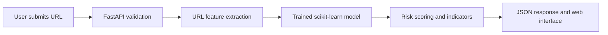
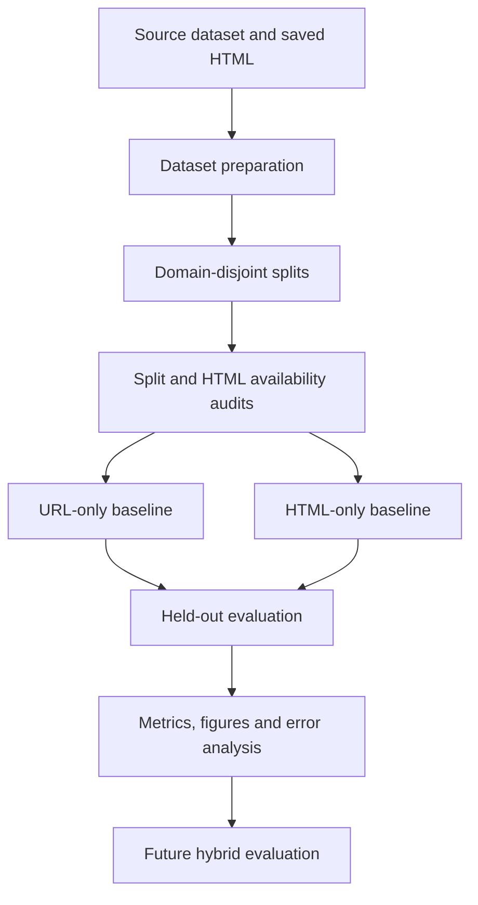

# PHISHGUARD

### Look twice before you trust a link.

**A research-oriented phishing detection system with machine-learning baselines, interpretable risk signals, and a customizable web interface.**

[](https://www.python.org/)
[](https://fastapi.tiangolo.com/)
[](https://scikit-learn.org/)
[](#limitations)

[Overview](#overview) · [Features](#features) · [Architecture](#architecture) · [Quick Start](#quick-start) · [Research Experiments](#research-experiments) · [Results](#measured-results) · [Limitations](#limitations)

---

## Overview

**PhishGuard** is a research-oriented phishing detection prototype that classifies submitted URLs and presents a model-derived risk score, suspicious URL indicators, and general safety recommendations.

The currently documented serving pipeline uses **URL-based features**. It does not automatically visit the submitted website, retrieve its HTML, verify the identity of the website owner, or guarantee that a link is safe.

The repository also contains separate research experiments investigating URL-only and HTML-only feature representations under domain-group-disjoint evaluation. These experiments are distinct from the model currently served by the web application.

The project's research objectives are to:

- Evaluate phishing detection on domains separated across training, validation, and testing.
- Compare URL-based and HTML-based feature representations.
- Maintain explicit sample alignment and document missing or unusable HTML.
- Report precision, recall, F1, average precision, ROC-AUC, and confusion matrices.
- Build a reproducible workflow that supports further investigation of hybrid URL-plus-HTML detection.

**Important:** The displayed risk score is derived from an uncalibrated model output. It must not be interpreted as a calibrated probability that a website is malicious.

## Features

| Area | Description |
|---|---|
| URL analysis | Lexical and structural URL feature extraction |
| Machine learning | Scikit-learn classification models |
| Model selection | Validation-based comparison using phishing-class F1 |
| Research evaluation | Domain-group-disjoint training, validation, and testing |
| HTML experiments | Five live-extracted HTML features evaluated on usable saved HTML |
| Risk report | Classification, uncalibrated score, rule-based indicators, and recommendations |
| API | FastAPI inference endpoints with request validation |
| Interface | Responsive frontend with ten configurable visual themes |
| Reproducibility | Training scripts, experiment reports, split audits, and research figures |

### URL features

The URL-only feature extractor includes signals such as:

- URL length and domain length
- IP-address hostnames
- HTTPS usage
- Dots, hyphens, `@` symbols, and other special characters
- Query-parameter counts
- Path slash counts
- Hostname digit ratio
- Punycode
- Explicit ports
- URL-character entropy
- Numeric character proportion

The exact feature definitions are implemented in [`backend/features/live_url_features.py`](backend/features/live_url_features.py).

### Live HTML features

The live HTML-only research baseline extracts five structural features from saved HTML:

1. `html_password_fields`
2. `html_form_count`
3. `html_iframe_count`
4. `html_external_scripts`
5. `html_external_form_actions`

These features are used in a separate research experiment. Their presence does **not** mean that the currently served URL-only endpoint retrieves and analyzes webpage HTML.

## Architecture

### Current serving pipeline



### Research evaluation pipeline



The research pipeline is not identical to the serving pipeline. A future hybrid model must have a verified feature extraction path, consistent sample alignment, and its own documented evaluation.

## Repository Structure

```text
Phishing-Detection-System/
├── backend/
│   ├── main.py
│   ├── features/
│   │   ├── live_url_features.py
│   │   └── html_features.py
│   ├── ml/
│   ├── risk/
│   └── security/
├── frontend/
│   ├── index.html
│   ├── css/
│   │   └── style.css
│   └── js/
│       ├── app.js
│       └── config.js
├── models/
│   ├── url_model.joblib
│   └── research_balanced/
├── data/
│   ├── raw/
│   └── processed/
│       ├── paired_dataset.csv
│       └── research_splits_balanced/
├── scripts/
│   ├── train_live_model.py
│   ├── train_url_baseline_balanced.py
│   ├── train_html_baseline_balanced_excluding_empty.py
│   ├── audit_splits.py
│   ├── generate_research_figures.py
│   └── run_experiments.py
├── reports/
│   └── research_balanced/
│       ├── research_report.md
│       ├── url_baseline_metrics.json
│       ├── html_live_excluding_empty/
│       └── figures/
├── tests/
├── requirements.txt
└── README.md
```

This tree highlights the principal application and research files. Individual experimental scripts and optional modules may have additional dependencies or different execution requirements.

## Quick Start

### Requirements

- Python 3.10 or later
- `pip`
- Git
- A local copy of the required model artifact

### 1. Clone the repository

```bash
git clone https://github.com/maanik-chandela/Phishing-Detection-System.git
cd Phishing-Detection-System
```

### 2. Create a virtual environment on macOS

```bash
python3 -m venv .venv
source .venv/bin/activate
python -m pip install --upgrade pip
pip install -r requirements.txt
```

### 3. Start the application

```bash
python -m uvicorn backend.main:app --reload --host 127.0.0.1 --port 8000
```

Open the following addresses in your browser:

- Application: http://127.0.0.1:8000/
- API documentation: http://127.0.0.1:8000/docs
- Health endpoint: http://127.0.0.1:8000/health

If port `8000` is already in use, stop the existing application process or choose another available port.

**Model artifact note:** The serving application may require `models/url_model.joblib`. Verify that this artifact is present before starting the application. Only load trusted `joblib` files because serialized Python artifacts can execute code when loaded.

## API Reference

### `GET /health`

Returns application health information and whether the predictor initialized successfully.

### `POST /analyze`

Example request:

```bash
curl -X POST http://127.0.0.1:8000/analyze \
  -H 'Content-Type: application/json' \
  -d '{"url":"https://example.com"}'
```

The application accepts supported HTTP and HTTPS URLs with a valid hostname.

The documented response fields include:

| Field | Meaning |
|---|---|
| `prediction` | `0` = classified legitimate; `1` = classified phishing |
| `phishing_probability` | Uncalibrated model output for the phishing class |
| `risk_score` | Rounded model output multiplied by 100 |
| `risk_level` | Risk category derived from the configured score thresholds |
| `indicators` | Suspicious signals generated by URL-specific rules |
| `recommendations` | General safety guidance |
| `features` | Extracted URL feature values |
| `model_name` | Model identifier |
| `analysis_mode` | Current documented mode: `URL-only` |
| `score_calibrated` | `false` |

The actual response schema is defined by the backend implementation. Consult `/docs` for the live API schema.

## Model Development

### Current serving model

The URL-only serving model is associated with [`scripts/train_live_model.py`](scripts/train_live_model.py).

The documented workflow:

1. Loads URL and label data from the configured source workbook.
2. Performs data cleaning and duplicate handling.
3. Extracts the URL features used by the serving pipeline.
4. Splits data by registered domain to reduce domain overlap.
5. Compares candidate models on validation performance.
6. Evaluates the selected model on held-out data.
7. Saves the resulting model artifact.

To retrain the serving model, ensure the required source data is present and run:

```bash
python -m scripts.train_live_model
```

The source workbook expected by this workflow is:

```text
data/raw/All_Features_threshold90.xlsx
```

The serving workflow and the balanced research baselines are separate pipelines. Their metrics should not be mixed without checking the data, feature definitions, split strategy, and evaluation procedure.

## Research Experiments

The repository contains a balanced research dataset with domain-group-disjoint train, validation, and test splits.

Split files:

```text
data/processed/research_splits_balanced/
├── train.csv
├── validation.csv
├── test.csv
└── split_metadata.json
```

### Dataset and split audit

Run:

```bash
python -m scripts.audit_splits
```

The audit checks split integrity, including domain-group overlap, duplicate sample IDs, labels, and split distributions.

The research split audit reported:

- Training records: 10,659
- Validation records: 2,379
- Test records: 2,320
- Cross-split domain-group overlaps: 0
- Duplicate sample IDs across splits: 0

The split-level phishing proportions are approximately 46–47%. The precise values and audit details should be taken from the saved audit artifacts.

### URL-only baseline

Run:

```bash
python -m scripts.train_url_baseline_balanced
```

This experiment uses 15 URL-based features and the balanced domain-disjoint splits.

Artifacts:

- Model: `models/research_balanced/url_baseline.joblib`
- Metrics: `reports/research_balanced/url_baseline_metrics.json`

### HTML-only baseline

Run:

```bash
python -m scripts.train_html_baseline_balanced_excluding_empty
```

This experiment uses five features extracted from saved HTML. Records with empty HTML are excluded rather than assigned an artificial feature vector or treated as legitimate.

Artifacts:

- Model: `models/research_balanced/html_live_excluding_empty/selected_live_html_model.joblib`
- Metrics and experiment summary: `reports/research_balanced/html_live_excluding_empty/experiment_summary.json`
- Excluded records: `reports/research_balanced/html_live_excluding_empty/excluded_records.json`

#### HTML availability and exclusions

The corpus audit identified eight empty HTML files across the original splits, even though their availability metadata indicated HTML was present.

| Split | Original records | Usable records | Excluded |
|---|---:|---:|---:|
| Train | 10,659 | 10,656 | 3 |
| Validation | 2,379 | 2,377 | 2 |
| Test | 2,320 | 2,317 | 3 |
| **Total** | **15,358** | **15,350** | **8** |

The HTML-only test results therefore apply to 2,317 usable test records, not all 2,320 records in the original test split.

### Hybrid URL + HTML baseline

A hybrid model is intended to combine URL and HTML features. Its results must be established by a verified experiment that documents:

- The exact URL and HTML feature definitions.
- Sample alignment across both modalities.
- Treatment of missing or empty HTML.
- Domain-disjoint split integrity.
- Validation-based model selection.
- Held-out test metrics and saved model artifacts.

Workbook-derived features must not be assumed equivalent to features produced by the live URL and HTML extractors.

**Hybrid results are not reported as verified in this README.** Any previous offline model comparison based on a different feature pipeline should remain explicitly provisional until its underlying artifacts and methodology have been checked.

### Run the experiment workflow

The repository includes an experiment runner:

```bash
python -m scripts.run_experiments
```

Review the individual scripts and their prerequisites before running the complete workflow. Some experiments may use different data requirements or stop when integrity checks fail.

## Measured Results

The table below reports the currently recorded results for the URL-only and five-feature live HTML-only baselines.

| Metric | URL-only baseline | Live HTML-only baseline |
|---|---:|---:|
| Test accuracy | 0.9004 | 0.6815 |
| Phishing precision | 0.8894 | 0.6230 |
| Phishing recall | 0.8984 | 0.8070 |
| Phishing F1 | 0.8939 | 0.7031 |
| Average precision | 0.9453 | 0.7068 |
| ROC-AUC | 0.9574 | 0.7835 |
| Test records evaluated | 2,320 | 2,317 |

The values are rounded for readability. Refer to the saved JSON files for full-precision results.

### URL-only confusion matrix

The URL-only baseline confusion matrix is:

| | Predicted legitimate | Predicted phishing |
|---|---:|---:|
| Actual legitimate | 1,116 | 121 |
| Actual phishing | 110 | 973 |

### Live HTML-only confusion matrix

The live HTML-only baseline confusion matrix is:

| | Predicted legitimate | Predicted phishing |
|---|---:|---:|
| Actual legitimate | 705 | 529 |
| Actual phishing | 209 | 874 |

### Interpretation

On the reported held-out test sets, the URL-only baseline achieved higher accuracy, phishing precision, and phishing F1 than the five-feature HTML-only baseline. The HTML-only model achieved phishing recall of 0.8070, but its precision of 0.6230 indicates a substantial false-positive burden.

These are results for two distinct feature representations. The HTML-only experiment excludes records with unusable saved HTML, while the URL-only baseline evaluates the original test split. The figures should therefore be interpreted with their data coverage and feature definitions in mind.

The results do not establish that URL-based detection is universally superior to HTML-based detection. Nor do they establish that a hybrid model will necessarily perform better. Those claims require controlled and reproducible experiments.

## Research Figures and Report

The detailed research report is available at:

[`reports/research_balanced/research_report.md`](reports/research_balanced/research_report.md)

Research figures are stored in:

[`reports/research_balanced/figures/`](reports/research_balanced/figures/)

The figure set includes:

1. Dataset split and HTML availability audit.
2. Offline workbook-feature model comparison, which remains provisional pending verification.
3. Live HTML-only test confusion matrix.
4. Live HTML-only test metrics.
5. Research evaluation workflow.

To regenerate the figures:

```bash
python -m scripts.generate_research_figures
```

Check that the underlying experiment metrics are current before regenerating or publishing the comparison figure. A figure should not be treated as validated evidence merely because it was successfully generated.

## Testing

Run the focused HTML feature and feature-alignment tests:

```bash
python -m pytest -q \
  tests/test_html_features.py \
  tests/test_feature_extraction_alignment.py
```

Additional research integrity tests include:

```bash
python -m pytest -q \
  tests/test_split_integrity.py \
  tests/test_feature_extraction_alignment.py \
  tests/test_model_input_alignment.py
```

Run the full suite only after confirming its dependencies and collection configuration. Some reference repositories or exploratory folders may contain tests that are unrelated to the main application.

Passing tests supports implementation correctness for the covered cases; it does not constitute a complete security assessment or establish model generalization.

## Frontend Customization

Theme settings are maintained in [`frontend/js/config.js`](frontend/js/config.js).

The frontend includes ten visual themes:

- Folio
- Signal
- Mono
- Liquid
- Terminal
- Atelier
- Cinema
- Orbit
- Archive
- Nocturne

Grid and visual-effect settings are configurable. Core layout and typography rules are defined in [`frontend/css/style.css`](frontend/css/style.css).

## Limitations

- **URL-only serving pipeline:** The currently documented application inference path uses URL features. The separate HTML research experiment does not imply live webpage HTML retrieval in the application.
- **Uncalibrated scores:** A score of 80/100 does not establish an 80% probability of phishing.
- **Incomplete HTML corpus:** Eight saved HTML files were empty and were excluded from the live HTML-only experiment.
- **Limited HTML representation:** Five structural HTML features cannot capture every semantic, visual, or behavioral signal relevant to phishing.
- **Dataset representativeness:** Performance on the available dataset may not generalize to future campaigns, unseen attack techniques, or different data distributions.
- **Domain generalization:** Domain-disjoint splits reduce domain leakage but do not guarantee robustness to temporal shifts or all unseen domains.
- **Hybrid evaluation:** A verified hybrid result requires documented feature provenance, sample alignment, and an independent held-out evaluation.
- **Dataset licensing:** Original dataset provenance and redistribution permissions must be checked before redistributing the data or publishing derived materials.
- **Security hardening:** Adversarial testing, drift monitoring, production deployment review, and independent external validation remain future work.

## Research Roadmap

- [x] Audit domain-disjoint split integrity.
- [x] Evaluate the URL-only baseline.
- [x] Audit saved HTML availability and identify empty files.
- [x] Evaluate the five-feature live HTML-only baseline on usable records.
- [x] Generate research figures and add them to the report.
- [ ] Verify workbook-derived model comparison metrics and feature provenance.
- [ ] Complete and validate the hybrid URL-plus-HTML experiment.
- [ ] Add confidence intervals and robustness analysis across repeated seeds or alternative samples.
- [ ] Complete dataset provenance and licensing documentation.
- [ ] Evaluate probability calibration and calibration error.
- [ ] Investigate temporal and domain shifts.
- [ ] Expand false-positive and false-negative analysis.
- [ ] Strengthen API integration tests and deployment security.
- [ ] Consider a public demo after a security review.

## Responsible Use

PhishGuard is intended for education, experimentation, and supplementary risk awareness.

It does not replace browser security protections, reputable threat-intelligence services, or careful verification of website identity. A low-risk prediction must not be treated as proof that a website is safe.

Do not enter credentials, payment information, or other sensitive data into suspicious websites based solely on this tool's output. Do not submit private browsing history or sensitive URLs to deployments you do not trust.

## Author

Developed by [Maanik Chandela](https://github.com/maanik-chandela) as a BTech computer science and data science project.

Repository: [maanik-chandela/Phishing-Detection-System](https://github.com/maanik-chandela/Phishing-Detection-System)

Contributions, reproducibility feedback, and suggestions are welcome through [GitHub Issues](https://github.com/maanik-chandela/Phishing-Detection-System/issues).

---

<div align="center">

**Think before you click.**

</div>
