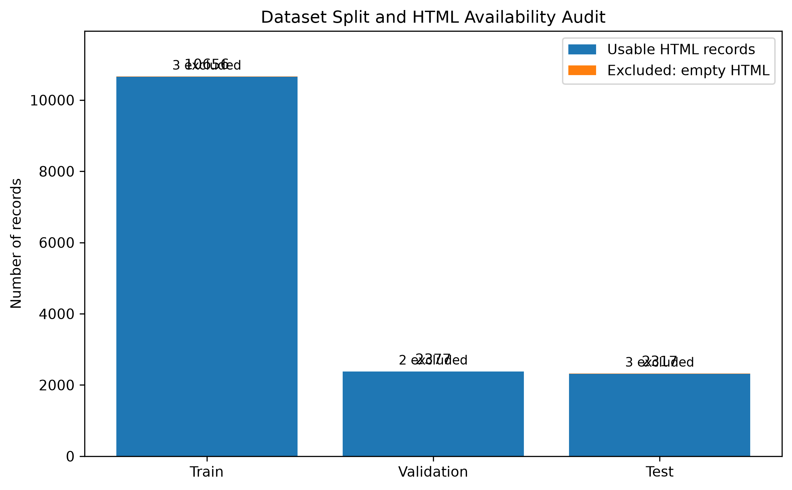
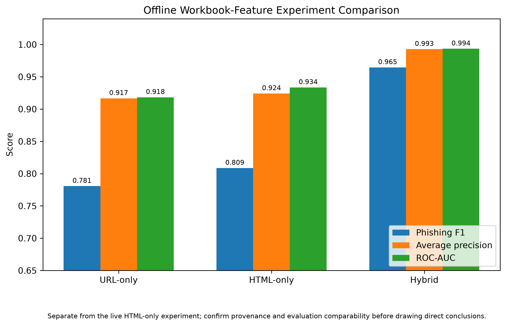
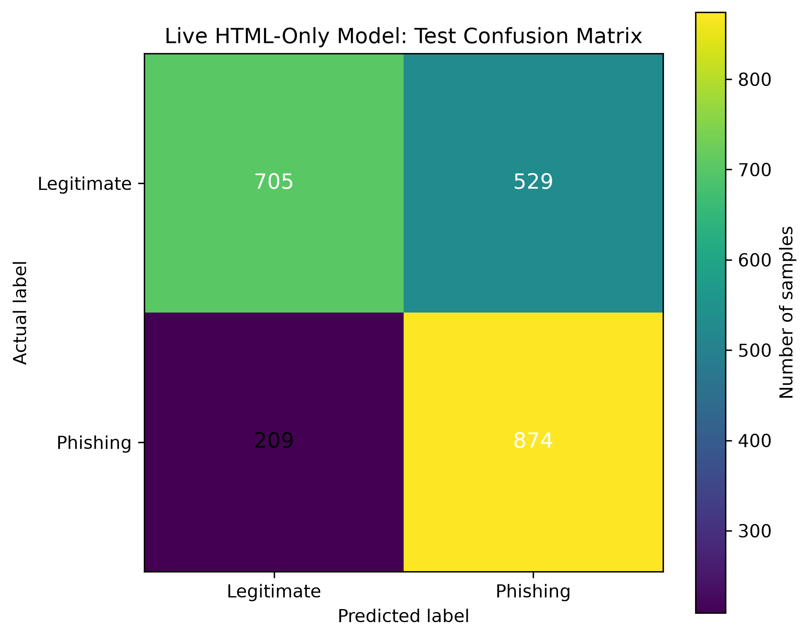
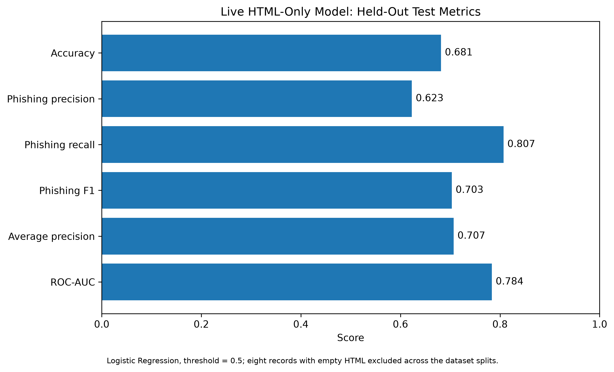
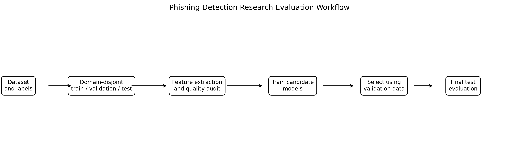

# Research Report: Balanced Domain-Disjoint Phishing Detection (Research Splits)

## Research question
How well do URL-only, HTML-only, and URL+HTML models generalize under strict domain-group disjoint splits (train/validation/test) on this dataset, with reproducible preprocessing and leakage-aware evaluation?

## Dataset provenance & limitations
- Source manifest: `data/processed/paired_dataset.csv` (constructed from `data/raw/All_Features_threshold90.xlsx` and saved HTML in `data/raw/All_HTML/`).
- Splits: `data/processed/research_splits_balanced/{train,validation,test}.csv` with metadata in `split_metadata.json`.
- **Limitations:** Redistribution rights of the original dataset must be verified by the dataset owners; this repo contains research data files. HTML corpus inspection shows 8 samples with empty saved HTML files despite `html_available=True` (see blocker). Spreadsheet-derived features are **not** assumed equivalent to live extractor features.

## Preprocessing
- URL features extracted via `backend.features.live_url_features.extract_url_features` (15 features). 
- HTML features extracted via `backend.features.html_features.extract_html_features` (5 features), using saved HTML files.
- All extractions fail hard on errors/missing/empty content (no silent imputation to legitimate).

## Domain-disjoint split strategy
- Method: Two-stage GroupShuffleSplit with candidate selection by record allocation and class-rate balance only (seed selection recorded). 
- Grouping by `domain_group`. 
- Audit confirms: **0 domain-group overlaps** across splits, **0 duplicate sample IDs**, both classes present in all splits.
- Split details: train 10659 (domains 6612, phishing rate 46.993%), val 2379 (domains 1417, 46.742%), test 2320 (domains 1417, 46.681%).

## Feature groups
- URL-only: url_length, domain_length, url_contains_ip, uses_https, no_of_dots, no_of_hyphen, no_of_at, special_characters_count, num_query_params, no_of_slashes_inpath, hostname_digit_ratio, has_punycode, has_explicit_port, url_entropy, numeric_proportion
- HTML-only (planned): html_password_fields, html_form_count, html_iframe_count, html_external_scripts, html_external_form_actions
- Hybrid (planned): concatenation of URL + HTML features

## Model selection
- Candidates: Logistic Regression (balanced, scaled) and Random Forest (balanced). 
- Selection metric: validation F1 for phishing class. **Validation used only for model selection; test evaluated only after selection.** Threshold 0.5.

## Results (measured)

### URL-only baseline (balanced, domain-disjoint) — COMPLETED
- Model: Random Forest
- Test: Accuracy 0.90043, Precision(phish)=0.88940, Recall(phish)=0.89843, F1(phish)=0.89389, AP=0.94532, ROC-AUC=0.95742
- Confusion matrix (test): [[1116, 121],[110, 973]] (legit, phish)

### HTML-only baseline — BLOCKED
- Blocked due to empty saved HTML for samples in all splits (8 total). See `reports/research_balanced/html_experiment_blocker.json`. No results fabricated.

### Hybrid URL+HTML — BLOCKED
- Blocked by same HTML data issue. No results fabricated.

## Limitations
- HTML corpus incomplete/unusable for full-split evaluation with strict alignment.
- Features from spreadsheet not assumed equivalent to live extractors.
- Domain generalization is constrained by group-disjoint split; performance on unseen TLDs/domains may differ.
- Models are research baselines, not production-hardened.

## Reproducibility
See `scripts/run_experiments.py` and exact commands below.

<!-- RESEARCH-FIGURES-SECTION -->
## Research Figures

### Dataset split and HTML availability audit

*Figure: Dataset split and HTML availability audit.*

### Offline workbook-feature model comparison (provisional)

*Figure: Offline workbook-feature model comparison (provisional).*

### Live HTML-only test confusion matrix

*Figure: Live HTML-only test confusion matrix.*

### Live HTML-only test metrics

*Figure: Live HTML-only test metrics.*

### Research evaluation workflow

*Figure: Research evaluation workflow.*

